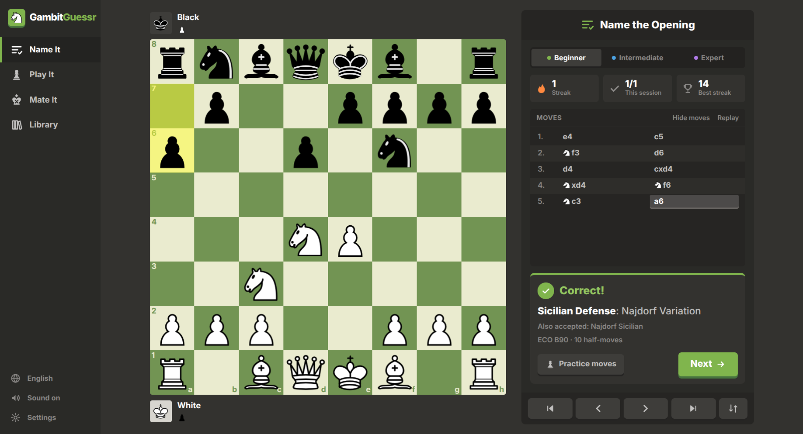
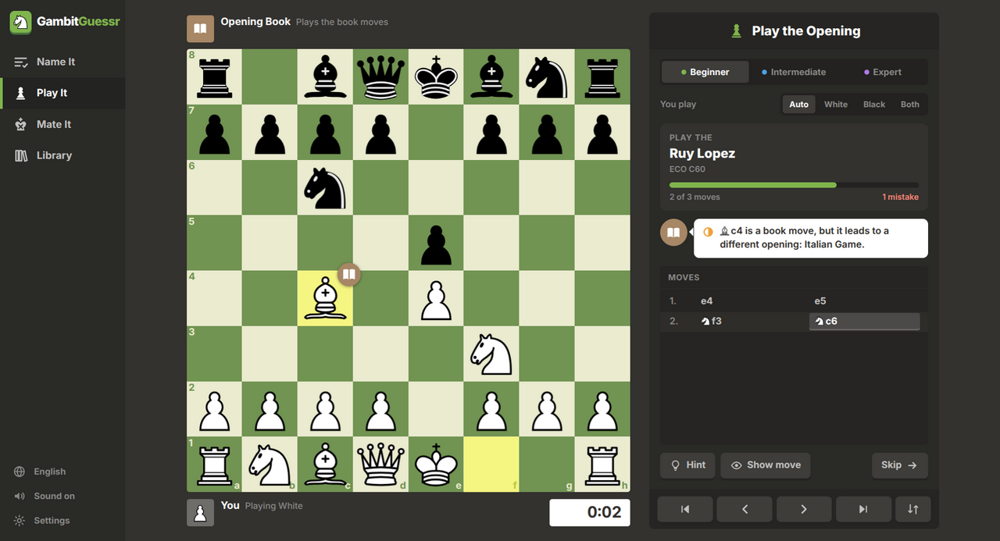
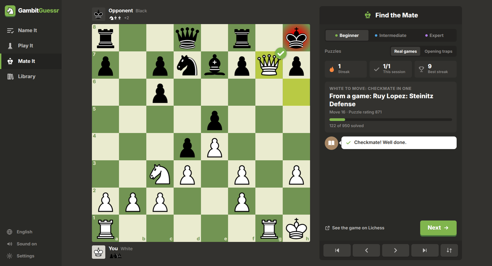
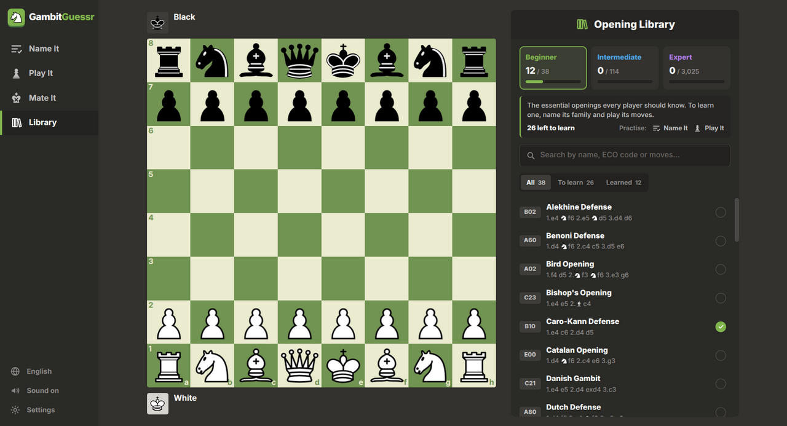
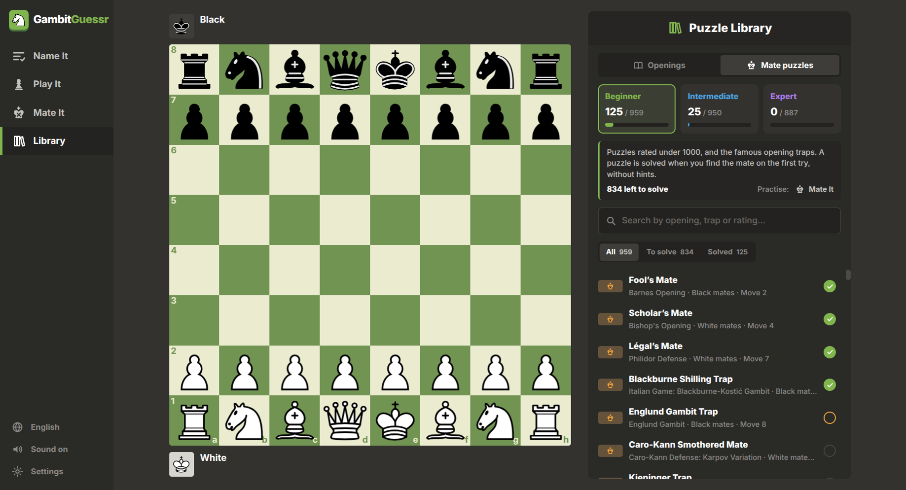
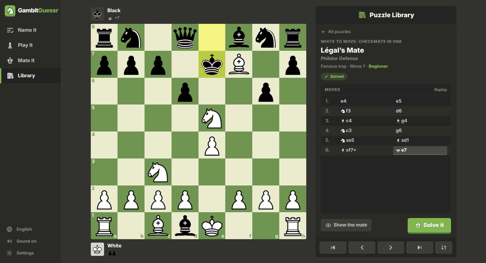
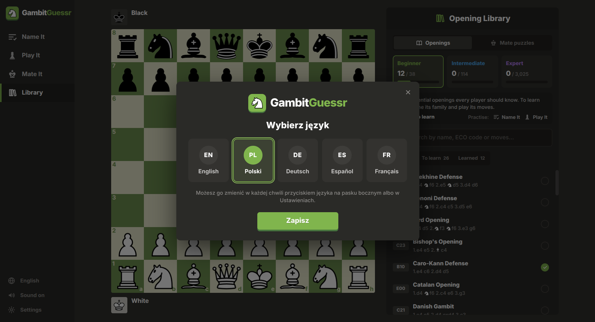
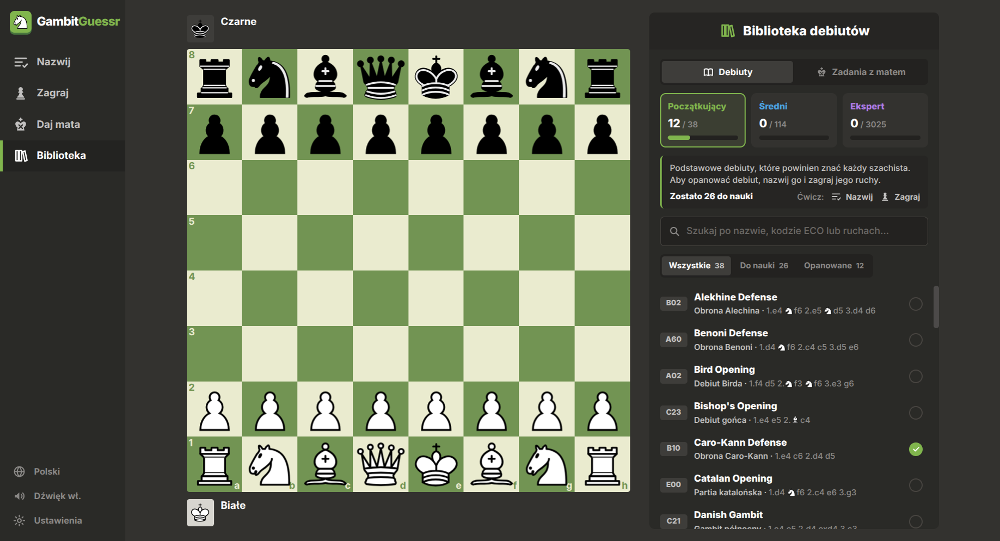
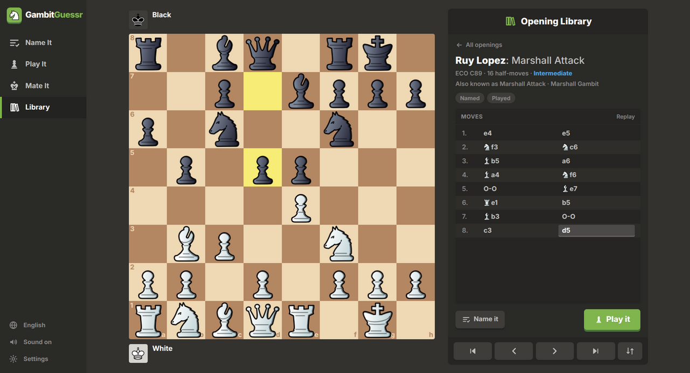

# GambitGuessr

**Learn chess openings by guessing them.** GeoGuessr drops you somewhere in the world and you
guess where. GambitGuessr plays out the first moves of a game and you guess the opening.
It can also name an opening for you to play on the board, or show you a position from a real
game where there's a checkmate in one to find.

It's a free desktop app for Windows and Linux, styled after chess.com's game screen.
- **Offline:** no account, ads or tracking.
- **Openings:** all 3,177 named openings from the Lichess opening database, from the Italian Game to the Sicilian Najdorf's English Attack.
- **Puzzles:** 2,787 mate-in-one puzzles from real games, plus famous opening traps.
- **Languages:** English, Polish, German, Spanish and French.



## Download

Get the latest version from the [**Releases page**](../../releases/latest).

### Windows

| | File | How |
|---|---|---|
| Windows 10 / 11 | `GambitGuessr-Setup-<version>.exe` | Run it. It installs in a few seconds and adds Start-menu and desktop shortcuts. |
| No install | `GambitGuessr-<version>-Portable.exe` | Just run it. |

The Windows files aren't code-signed, so Windows may show *"Windows protected your PC"*.
Click **More info → Run anyway**.

### Linux

Every package below is tested by installing it and starting the app in the official
Linux Mint, Fedora, Arch Linux and Gentoo containers, on every change
([Linux distros workflow](../../actions/workflows/linux.yml)).

| Distro | File | Install |
|---|---|---|
| **Linux Mint**, Ubuntu, Debian, Pop!_OS, Zorin, elementary | `gambitguessr_<version>_amd64.deb` | Double-click it, or `sudo apt install ./gambitguessr_<version>_amd64.deb` |
| **Fedora**, openSUSE, RHEL, Nobara | `gambitguessr-<version>.x86_64.rpm` | `sudo dnf install ./gambitguessr-<version>.x86_64.rpm` (openSUSE: `sudo zypper install …`) |
| **Arch Linux**, Manjaro, EndeavourOS, CachyOS | `gambitguessr-<version>.pacman` | `sudo pacman -U gambitguessr-<version>.pacman`, or build the AUR recipe in [`packaging/arch`](packaging/arch) |
| **Gentoo** | ebuild in [`packaging/gentoo`](packaging/gentoo) | Copy `games-board/gambitguessr-bin` into a local overlay, then `emerge games-board/gambitguessr-bin` |
| Any distro, no install | `GambitGuessr-<version>.AppImage` | `chmod +x GambitGuessr-*.AppImage`, then run it. It doesn't need the old `libfuse2`. |
| Any distro, manual | `gambitguessr-<version>.tar.gz` | Unpack it anywhere and run `./gambitguessr` |

After installing a package, GambitGuessr appears in your app menu under Games, and
`gambitguessr` starts it from a terminal.

<details>
<summary>Gentoo: setting up a local overlay</summary>

```
sudo mkdir -p /var/db/repos/local/{metadata,profiles}
echo local | sudo tee /var/db/repos/local/profiles/repo_name
printf 'masters = gentoo\nthin-manifests = true\n' | sudo tee /var/db/repos/local/metadata/layout.conf
printf '[local]\nlocation = /var/db/repos/local\n' | sudo tee /etc/portage/repos.conf/local.conf
sudo cp -r packaging/gentoo/games-board /var/db/repos/local/
echo 'games-board/gambitguessr-bin ~amd64' | sudo tee /etc/portage/package.accept_keywords/gambitguessr
sudo emerge games-board/gambitguessr-bin
```

Turn on the `suid` USE flag only if your kernel has unprivileged user namespaces
disabled.
</details>

<details>
<summary>If the app doesn't start on Linux</summary>

- **AppImage won't open:** it needs FUSE, which every desktop distro has. On a very minimal
  system, install `fuse3`, or run it with `--appimage-extract-and-run`.
- **Sandbox error with the `.tar.gz`:** some distros disable unprivileged user namespaces,
  which the sandbox needs. Use the `.deb`, `.rpm`, pacman package or AppImage, which handle
  this, or start it with `./gambitguessr --no-sandbox`.
</details>

## How it works

### Name It: guess the opening

The moves play out on the board and you type the opening's name.
- Spelling mistakes and missing words like "Defense" are fine.
- Nicknames work too: *Spanish* for the Ruy Lopez, *Petroff*, *QGD*, *KID*, *Caro Kann*, *Gruenfeld*.
- If you get the opening right but not the variation, you're told so and can try again.
- **Hint** reveals the name little by little.
- A streak counter keeps you honest.

### Play It: play the moves

You're given the name of an opening and play its moves by dragging pieces or clicking
them. The app answers with the book moves for the other side.



- A correct move gets a green ✓, and a wrong one gets a red ✕ and is taken back.
- A real opening move that belongs to another line gets a book icon, with the name of the opening it leads to.
- A move from later in the line gets an amber icon.
- **Hint** shows which piece to move, then the arrow.
- **You play: Auto** gives you the side that owns the opening: Black for the Sicilian, White for the Ruy Lopez.

### Mate It: find the checkmate



Your opponent's last move is played on the board, and you find the checkmate in one.
- Every position comes from a real game, and the app shows which opening that game was.
- Any mating move counts, even if it's not the one played in the game.
- **Opening traps** starts with famous traps, each shown move by move before you deliver the final blow:
  Fool's Mate, Scholar's Mate, Légal's Mate, the Blackburne Shilling, Englund, Kieninger and Siberian traps, and more.
  After those come real games that ended in mate by move 10.
- The levels follow the puzzles' Lichess ratings:
  - Beginner: rated under 1000.
  - Intermediate: 1000–1599.
  - Expert: 1600 and up.
- A wrong move gets a red ✕ and is taken back.
- **Hint** shows which piece mates, then the arrow.
- After solving, you can open the original game on Lichess.

### Library: see what's left to learn



The Library has two shelves, **Openings** and **Mate puzzles**. Both are split into the same three
categories, and each category shows how much of it you've done.

**Openings:**
- **Beginner:** the 38 openings every player should know. You name the family, e.g. "Sicilian Defense".
- **Intermediate:** 114 popular variations. You name the variation too, e.g. "Sicilian Defense: Najdorf Variation".
- **Expert:** the other 3,025 named openings. You give the full name.

An opening counts as **learned** once you've named it on the first try and played it without
mistakes or hints. The **To learn** filter shows exactly what stands between you and
completing a category. Openings you get wrong come back more often.



**Mate puzzles:** every Mate It puzzle, easiest first.
- **Beginner:** the 9 famous opening traps and 950 puzzles rated under 1000.
- **Intermediate:** 950 puzzles rated 1000–1599.
- **Expert:** 887 puzzles rated 1600 and up.

A puzzle counts as **solved** once you've found the mate on the first try without a hint.
- **Find a puzzle:** search by opening (in any of the five languages), trap name or rating, or filter by **To solve** and **Solved**.
- **Open a puzzle:** step through the moves that led to it, or reveal the mate. A revealed puzzle counts as tried, not solved.
- **Solve it** opens that puzzle in Mate It.



### In your language



The first time you start GambitGuessr, it asks which language you want: **English, Polski,
Deutsch, Español or Français**. Your computer's language is preselected, and your choice is
remembered. You can change it any time with the 🌐 language button at the bottom of the
sidebar, or in Settings.
- **Opening names:** the common ones show in your language too: *Obrona sycylijska*, *Sizilianische Verteidigung*, *Defensa siciliana*, *Défense sicilienne*.
- **Name It answers:** these names are accepted in any of the five languages.
- **Variation names:** these stay in their international English form, as on Lichess.
- **Moves:** they're written with small piece pictures (♘f3) instead of letters, so they read the same everywhere.



### Make it yours



- **Settings:** 7 piece sets, 5 board colours, animation speed, sound, legal-move dots and coordinates.
- **Board marks:** right-click a square to mark it, or right-drag to draw an arrow, just like on chess.com.

**Keyboard:**

| Key | Does |
|---|---|
| `Enter` | submit the answer or go to the next opening |
| `←` `→` `↑` `↓` | step through the moves |
| `Esc` | back to the list (Library) |
| `F` | flip the board |
| `H` | hint (Play It, Mate It) |
| `1` `2` `3` `4` | switch between Name It, Play It, Mate It and Library |

## Run from source

You need [Node.js](https://nodejs.org/) 20 or newer.

```
git clone https://github.com/nokkiee/gambitguessr.git
cd gambitguessr
npm install
npm start
```

| Command | Does |
|---|---|
| `npm test` | unit tests: answer checking, translations, the whole opening dataset and every puzzle |
| `npm run test:e2e` | drives the real app with mouse and keyboard and saves screenshots (Linux) |
| `npm run dist` | builds the Linux AppImage, .deb, .rpm, pacman package and .tar.gz into `dist/` (`.rpm` needs `rpm`, pacman needs `bsdtar`) |
| `npm run dist:win` | builds the Windows installer and portable .exe (on Windows, or on Linux with Wine) |
| `npm run data` | rebuilds `renderer/data/openings.json`; add `-- --fetch` to re-download from Lichess |
| `npm run puzzles` | rebuilds `renderer/data/puzzles.json` from the Lichess puzzle database; add `-- --fetch` to download it (about 300 MB) |
| `npm run install-desktop` | adds the source version to your Linux app menu |

Where things are:
- `data/curated.js`: the hand-picked Beginner and Intermediate openings, with their nicknames and representative lines.
- `renderer/js/grading.js`: decides whether a typed name is right.
- `renderer/js/board.js`: the chessboard, covering drawing, animation, drag and drop, and arrows.
- `renderer/js/modes/`: the four screens.
- `renderer/i18n/`: the translations, one file per language. English is the reference.
- `renderer/data/opening-names.json`: opening names in other languages.

Contributions are welcome, especially:
- more nicknames and better representative lines
- more of the openings people actually play in the Beginner and Intermediate lists
- translation fixes, or a new language: copy `renderer/i18n/en.js` and add it to `renderer/js/i18n.js`. The tests check that nothing is missing.

## License

GambitGuessr is free software under the [GNU GPL v3.0 or later](LICENSE).
- **Opening data:** from [lichess-org/chess-openings](https://github.com/lichess-org/chess-openings), public domain (CC0).
- **Puzzles:** from the [Lichess puzzle database](https://database.lichess.org/#puzzles), also CC0.
- **Bundled pieces, font and libraries:** these keep their own free licenses, listed in [THIRD_PARTY_NOTICES.md](THIRD_PARTY_NOTICES.md).
- **Not affiliated with chess.com or GeoGuessr:** it uses none of their artwork, sounds or code.
